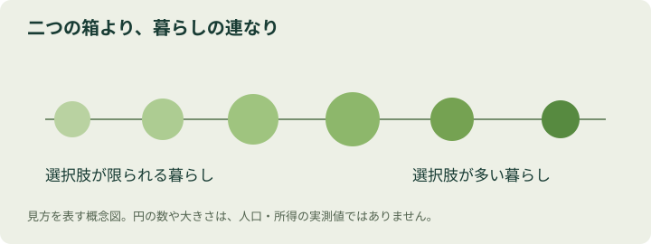

# 第2章：分断本能 — 世界の真ん中が、消えてしまう

> この章のひと言：二つに分かれて見えるときほど、その間にいる人を探そう。

## 1. 学習目標
- 「豊かな国／貧しい国」という区分で何が隠れるかを説明する。
- 所得の4つのレベルを、暮らしの違いとしてイメージする。
- 平均の差と、一人ひとりの違いを分けて読む。

## 2. 導入ケース：二種類しかない世界？
旅行番組では、高層ビルの街の次に、水をくむため遠くまで歩く村が映ります。二つの映像だけを見れば、世界には便利な都市と、とても貧しい村しかないように感じられます。

でも、自転車で買い物に行く家庭は？ 電気は来ているけれど停電もある家庭は？ 冷蔵庫を買い、次はバイクを買おうと貯金している家庭は？ 私たちの頭の中の地図から、そんな「途中の暮らし」が抜け落ちているかもしれません。

## 3. 考えてみよう
自分が外国の生活を思い浮かべるとき、浮かぶのは観光地でしょうか、ニュースの現場でしょうか。それは、そこに住む人の普通の一日を代表しているでしょうか。

## 4. 基本解説：二分法は、世界を小さくしすぎる
分断本能は、違いを見つけると、二つのまとまりとその間の大きな溝を想像したくなる傾向です。『FACTFULNESS』を読むうえで大切なのは、「貧しい暮らしは存在しない」という話ではなく、豊かさには段階があり、二択では生活を捉えきれないという視点です。

そこで登場するのが、所得を4つのレベルで見る考え方です。以下は理解のための生活イメージで、全家庭を分類するチェックリストではありません。

|レベル|暮らしを見るときのイメージ|
|---|---|
|1|水や燃料を手に入れるため、多くの時間と労力が必要|
|2|自転車や照明などが、移動や家事の選択肢を広げる|
|3|水道や冷蔵庫、安定した移動手段が暮らしを変える|
|4|自動車や飛行機など、多くのサービスを選びやすい|

「どの国か」だけでなく、「どのくらいの所得で、どんな生活をしているか」を見ると、遠い国の家庭に自分の家と似た道具を見つけることがあります。反対に、同じ国の中にも大きな生活の違いがあります。国境と生活水準の境界は一致しません。

[Dollar Streetの公式公開コード](https://github.com/Gapminder/dollar-street-pages/blob/beffa64ec96facebbdb9266210452f096bf8714e/src/index.html)でも、国の固定観念を写真で見直す趣旨が示されています。写真を見比べる楽しさは、数字の丸暗記とは違う入口になります。

<figure><figcaption>豊かさを二つに分けず、連続する暮らしとして捉える概念図（教材独自の概念図）</figcaption></figure>

## 5. 具体例：平均の間に、壁はない
**例1・会社の給与（架空データ）**。本社の月給は25・30・35・40・70万円、支店は24・29・34・39・44万円です。平均は本社40万円、支店34万円。ところが中央値は35万円と34万円です。中央値とは、小さい順に並べた中央の値のこと。平均には6万円の差があっても、ほとんどの人の給与は近い範囲にあります。「本社の人は全員豊か」とは言えません。

**例2・旅行先の家庭**。「この国は貧しい」と聞いていても、実際に訪ねた家にスマートフォンや洗濯機があって驚くかもしれません。その驚きは、相手が例外だからではなく、自分の分類が粗かったためかもしれません。どちらか一軒を国全体の代表にしないことが肝心です。

## 6. 対処法：集団の内側をのぞく
「二つに分かれている」と聞いたら、まず中間の層を探します。次に、それぞれの集団で値がどのように散らばっているかを見ます。この散らばりが**分布**です。

平均の差を示す図を見たら、「両方の集団に、同じくらいの値の人はいないか」と聞いてみましょう。差が小さいと言いたいのではありません。誰にどんな支援や対応が必要かを、集団の名前だけで決めないための確認です。

## 7. 注意点：4段階も、現実そのものではない
所得レベルは見方を増やす道具です。家庭の設備は、物価、気候、公共サービス、家族構成でも変わります。レベルの境界額は物価調整の基準にも関わるため、ここでは未照合の金額を掲げません。国別の平均所得と個人の所得も同じものではありません。

貧困の深刻さを「連続しているから差はない」と薄めないでください。二分法を外すと、むしろ、水をくむ負担、電気の不安定さ、医療への距離など、解決したい違いが具体的に見えてきます。

## 8. 演習
解答は付録の第2章にあります。先に自分の回答と理由を書きましょう。

**2-Q（選択）** 平均差を見たときの適切な判断は？

A. 本社の全員が支店の全員より高給だ／B. 中央値と分布も調べる／C. 平均には意味がない

**2-W（短い記述）** 上の給与データで中央値の差を求め、平均差と違う理由を書こう。

**2-P（実践課題）** 「都会と地方」「若者と高齢者」など身近な二分法を一つ選び、集団内部で違いそうな条件を三つ挙げる。

## 9. 章の要点
- 世界を二つに分けると、中間の暮らしが消えやすい。
- 国の平均と、そこに住む個人の生活は別。
- 平均だけでなく分布と重なりを探す。

この章の読み方と資料：原作の枠組みを踏まえた独自の解説です。原作本文を逐語照合したものではありません。[参考文献・調査範囲](references.md)に、確認できた公開資料と未確認の範囲をまとめています。
