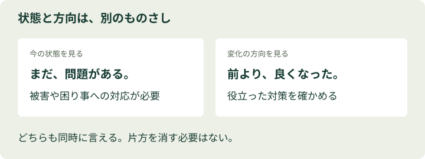

# 第3章：ネガティブ本能 — 悪い。でも、前より良い。

> この章のひと言：「今の状態」と「変わってきた方向」は、別々に確かめよう。

## 1. 学習目標
- 悪いニュースが集まりやすい理由を説明する。
- 深刻な問題と改善の両方を、同時に捉える。
- 一件の出来事を長期の流れの中に置き直す。

## 2. 導入ケース：今日も世界は悪くなった？
寝る前にスマートフォンを開くと、事故、不正、災害の見出しが続きます。「昔より、ずいぶんひどい世の中になったな」。そう思って画面を閉じたことはないでしょうか。

一方で、今日、水道が普通に使えた家庭はニュースになりません。子どもが昨日より少し上手に字を書けたことも、ある病院が毎日の診療を無事に終えたことも、見出しにはなりにくい出来事です。私たちが見たのは世界全体ではなく、今日、報じる理由があった出来事の集まりなのです。

## 3. 考えてみよう
「世の中が悪くなった」と感じるとき、何の指標について、いつと比べているでしょうか。自分の経験、報道の件数、社会全体の変化を分けてみてください。

## 4. 基本解説：悪い知らせを受け取る仕組み
ネガティブ本能を学ぶ核心は、悪い情報を無視することではありません。悪い出来事の方が自分の目に届きやすい、と覚えておくことです。

報道には、異常を知らせ、権力を監視し、被害を伝える大切な役割があります。しかし、その日のニュースを積み重ねるだけでは、何十年もかけた緩やかな改善は見えにくくなります。調査が進んで、以前は見逃されていた問題が多く見つかることもあります。報告が増えたことと、発生が増えたことは同じではありません。

もう一つの落とし穴は、「悪い」と「良くなっている」を反対語だと思うことです。重い病気の人が治療で少し回復したとき、状態はまだ悪くても、回復は本物です。社会についても同じ見方ができます。

世界のすべてが良い方向に動くわけではありません。指標によって、改善、停滞、悪化は違います。それでも、良くなった事実があれば認める。その上で、残る問題を考える。この二つを両立させると、必要以上の絶望も、根拠のない楽観も減らせます。

<figure><figcaption>現在に問題があっても、改善していることは両立する（教材独自の概念図）</figcaption></figure>

## 5. 具体例：被害と改善を、両方数える
**例1・サービスの不具合（架空データ）**。昨年は利用10万件で不具合200件、今年は20万件で300件でした。不具合の件数は増えています。しかし割合は、200÷100000×100＝0.2%から、300÷200000×100＝0.15%へ低下しました。

利用一件当たりでは改善し、対応すべき不具合の総数は増えた。どちらも事実です。「率が下がったから苦情を気にしなくてよい」でも「件数が増えたから改善は無意味」でもありません。

**例2・残業の削減（架空データ）**。ある人の残業が月40時間から30時間に減りました。改善は10時間。それでも本人が疲れ切っているなら、対策を続ける必要があります。改善を認めることは、つらさを否定することではないのです。

## 6. 対処法：見出しに、時間軸を足す
気になるニュースに出会ったら、「一年前は？ 十年前は？」と聞いてみます。ただし、都合の良い開始年だけを選ばないよう、複数の期間を見ます。件数と割合、対象の定義、報告方法も揃えましょう。

悪化を疑う気持ちに対して、無理に良い話を一つ並べても比較にはなりません。同じ問題を、同じ指標で追うことが必要です。悪い記事と明るい記事を同じ数だけ読めば中立、という話でもありません。

## 7. 注意点：改善は、支援をやめる理由ではない
改善を見つけたら、「何が効いたのか」を尋ねてください。支援や制度のおかげで改善したのなら、それをやめると逆戻りするかもしれません。良い変化は、何もしなくても自然に続く保証ではありません。

また、社会全体の平均が良くなっていても、特定の地域や人には届いていないことがあります。大きな時間軸で方向を確かめたら、小さな単位に戻って、誰が取り残されているかを見る。ここまでが一組です。

## 8. 演習
解答は付録の第3章にあります。先に自分の回答と理由を書きましょう。

**3-Q（選択）** 不具合件数が増え、率が減った場合は？

A. 品質は必ず悪化した／B. 被害は存在しない／C. 件数と率を別々に評価する

**3-W（短い記述）** 上の率の変化をポイントと相対変化で示そう。

**3-P（実践課題）** 最近の悪いニュースについて、同じ指標の複数年の推移を探す。見つからなければ「長期傾向は未確認」と記録する。

## 9. 章の要点
- ニュースの量は、出来事の発生率ではない。
- 悪い状態と、良くなっている方向は両立する。
- 長期の変化と、取り残された人の両方を見る。

この章の読み方と資料：原作の枠組みを踏まえた独自の解説です。原作本文を逐語照合したものではありません。[参考文献・調査範囲](references.md)に、確認できた公開資料と未確認の範囲をまとめています。
