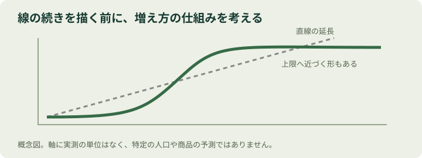

# 第4章：直線本能 — 定規で引いた未来は、どこまで続く？

> この章のひと言：伸びていると分かったら、次は「どんな形で？」を聞こう。

## 1. 学習目標
- 直近の増加をそのまま延ばす予測の前提に気づく。
- 直線、S字、頭打ちなどの違いを説明する。
- 人口と普及率を、増減の仕組みから考える。

## 2. 導入ケース：人気アプリの未来
新しいアプリが好調です。利用者は毎月100人ずつ増えています。会議で誰かが、現在の点から右上へ線を引きました。「来年は、ここまで行きます」。

きれいな線です。けれど、その地域でアプリを使える人は全部で1000人。すでに800人が使っています。線を一年延ばせば2000人。いつの間にか、使う人が対象者より多くなってしまいました。ここに出てくる人数は、演習用の架空データです。

## 3. 考えてみよう
自分が見た成長予測に、対象者の上限は書かれていたでしょうか。新しく使う人だけでなく、やめる人も数えられていたでしょうか。

## 4. 基本解説：線の形は、仕組みで変わる
直線本能は、いま見えている増加や減少が、その先も同じ調子で続くと考えたくなる傾向です。短い区間では直線に見えても、長い期間には曲がるかもしれません。

たとえば、子どもの身長が一定の割合でずっと伸び続けるとは考えないはずです。ところが社会のグラフになると、私たちは簡単に定規を当ててしまいます。大切なのは、線の続きを描く前に、その線を動かしている理由を考えることです。

|形|見方の例|
|---|---|
|直線|一定の量ずつ増える|
|指数的な増加|一定の割合で増え、増加量も大きくなる|
|S字|初めは緩やか、途中で加速し、やがて上限へ近づく|
|頭打ち|増えていたものが一定水準へ近づく|

どれも未来を必ず当てる魔法の型ではありません。普及率なら対象の中で100%を超えないという制約がありますが、人数なら対象人口が変わることがあります。何を測っている線なのかが先です。

原作が人口を扱う視点も、単に「今の伸び率を延ばす」発想を離れるためのものです。人口の変化には、出生、死亡、移動、現在の年齢構成が関わります。生まれる子どもの数がすぐ増えなくても、大きな世代が大人になることで総人口が増える場合があります。「子どもが増えるから」だけでは説明できないのです。

<figure><figcaption>直線の延長と、途中から頭打ちになる曲線の概念的な比較（教材独自の概念図）</figcaption></figure>

## 5. 具体例：何が増えているのか
**例1・アプリの上限（架空データ）**。800人に毎月100人の純増を12か月足すと、800＋100×12＝2000人。対象が1000人のままなら成立しません。対象地域が広がるという予測なら、その拡大の時期と根拠が必要です。

**例2・店の常連客**。開店直後は近所の人が次々に一度目の来店をするかもしれません。しかし、同じ商圏で新規客が同じ数ずつ増え続けるとは限りません。再来店が増えれば売上は伸びても、新規客数は頭打ちになることがあります。新規客、来店回数、売上のグラフを混同しないでください。

## 6. 対処法：未来の線に、条件を書き添える
予測を見るときは、「いつまで」「何が一定なら」「上限はどこか」を尋ねます。人口なら年齢構成、商品なら市場規模、仕事なら人員や処理能力など、変化を生む条件を一つずつ挙げてみましょう。

低め・中くらい・高めの複数の見通しを作ると、どの前提が結果を左右するかも見えてきます。ただし、三本の線を引くだけでは不十分。それぞれの線で変えた仮定を言葉にします。

## 7. 注意点：曲線なら正しい、ではない
「どれもS字になる」と決めつけるのも別の思い込みです。制度変更、戦争、技術革新などで、過去とは違う動きになることがあります。予測には対象期間があり、新しい情報で更新する必要があります。

また、累計の利用者数と今月の利用者数は違います。前者が増えていても、今月の利用は減っているかもしれません。形に目を奪われる前に、縦軸の意味と横軸の時間間隔を読みましょう。

## 8. 演習
解答は付録の第4章にあります。先に自分の回答と理由を書きましょう。

**4-Q（選択）** 対象1000人、利用800人のとき最初に確認するのは？

A. 同じ純増が永遠に続く／B. 未利用者数と対象者の変化／C. 必ず来月減少する

**4-W（短い記述）** 月100人増を12か月延長した人数を計算し、必要な追加仮定を示そう。

**4-P（実践課題）** 一つの将来予測を選び、期間、形、上限、変化する条件を表にする。低位・中位・高位の仮定を言葉で書く。

## 9. 章の要点
- 目先の傾きだけでは、その先の形は分からない。
- 上限、年齢構成、対象者など変化の仕組みを考える。
- 予測は条件つきの見通しとして更新する。

この章の読み方と資料：原作の枠組みを踏まえた独自の解説です。原作本文を逐語照合したものではありません。[参考文献・調査範囲](references.md)に、確認できた公開資料と未確認の範囲をまとめています。
